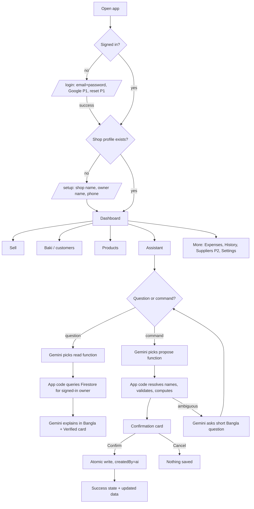

# AppFlow.md — Application Flow

## 1. Entry points
`/login` (unauthenticated default) · `/` Dashboard (authenticated) · deep links to `/customers/:id`. Unknown route → friendly 404 with "Go to Dashboard".

## 2. Navigation map
Bottom navigation (phone) / left rail (desktop): **Home · Sell · Baki · Products · Assistant**. "More" menu: Expenses (P1), Suppliers (P2), Sales history (P1), Settings (Judge Mode, Logout). Protected routes redirect to `/login`; authenticated users without a shop profile redirect to `/setup`.

## 3. Screen-by-screen journey
| Screen | Purpose | Primary actions | States |
|---|---|---|---|
| Login | Access | Sign in, Create account, (P1) Google, Forgot password | loading, invalid credentials, network error |
| Setup | First-time profile | Save shop name/owner/phone | validation errors, saving, error+retry |
| Dashboard | Overview | Quick buttons: New sale, Add baki payment, Ask assistant; cards: today's sales, est. profit, total baki, low stock; "Who owes most" top 3 | **empty** (first-time guide + "Add first product" + (P1) "Load demo data"), loading skeletons, error+retry |
| Products | Manage catalog | Add, Edit, Search, Archive (confirm) | empty, no results, saving |
| Sell | Create a sale | Choose products (search), qty, price (defaults to sell price), payment type, customer if baki, Review → Save | empty cart, negative-stock warning, duplicate warning (P1), saving, success + (P2) receipt |
| Baki list | Customers | Add customer, search, total outstanding, sorted by balance | empty, no results |
| Customer ledger | One customer | Record payment, give baki (manual), view every entry | empty ledger, overpayment warning |
| Assistant | Chat | Type, (P2) mic, Send, Retry, Confirm/Cancel on cards | idle with 4 example chips, thinking, answer, clarification, confirmation card, error+Retry |
| Expenses (P1) | Costs | Add, list by date | empty, saving |
| History (P1) | Past sales | Filter by date | empty |
| Settings | Account | Load/Remove demo data (P1), Logout | confirm dialogs |

## 4. Golden Path sequence (identical to PRD §8)
GP-1 sign in + setup → GP-2 add Sugar → GP-3 cash sale 2 kg (৳260, stock 48) → GP-4 baki sale 3 kg to new customer Rahim (৳390, stock 45) → GP-5 payment ৳200 (balance ৳190) → GP-6 ask "Kar kache sob theke beshi baki ache?" → GP-7 command "Rahim ke 500 taka baki dilam" → Confirm → balance ৳690 → GP-8 refresh; data persists.

## 5. Decision points and alternate paths
- **Insufficient stock** on sale: warning dialog "Only N left. Sell anyway?" (stock goes negative only after explicit acceptance, flagged `negativeStockAccepted`); default action = Edit quantity.
- **Baki without customer:** inline "Add new customer" (name + phone) without leaving the sale.
- **Payment greater than balance:** warning "This is more than Rahim owes (৳190). Record as advance?" Default: Cancel. (Advance creates a negative balance, displayed as "advance".)
- **Duplicate (P1):** same customer+amount+type within 10 min → "Looks like a duplicate of the entry at HH:MM. Save anyway?"
- **Ambiguous customer/product in the assistant:** Gemini asks a short Bangla question listing candidates with phone last-4 (e.g., "Rahim (…0001) নাকি Rahim (…0004)?"); the user's answer continues the same chat session; no record is written until Confirm.
- **Unknown customer in a command:** card offers "Create customer 'Rahim' (add phone later)" as an explicit option; never auto-creates.

## 6. Form and action flows
Every form: client validation inline → disabled submit while saving → success only after the write resolves → on failure keep all input, show error + Retry. Destructive actions (archive, remove demo data, logout with unsaved cart) use confirm dialogs.

## 7. Assistant interaction flow (detail)
1. User sends text (or edited voice transcript). The raw text is shown in the chat.
2. App sends it to Gemini with the system instruction and the **function declarations only**.
3. Gemini returns text or a function call. App validates the call against the allowlist and schema.
4. **Read function:** code queries Firestore (scoped to the signed-in uid), returns allowlisted fields; Gemini writes a Bangla explanation; UI shows the explanation and a **Verified from your data** card built from the same result (not from Gemini text).
5. **Propose function:** code resolves entities, validates, computes totals, and returns a proposal; UI renders the **confirmation card** from code values. Gemini adds one short Bangla sentence ("এই এন্ট্রিটি নিশ্চিত করবেন?").
6. **Confirm** → atomic write → success message in Bangla + English label; **Cancel** → "Cancelled, nothing saved".
7. Gemini failure/timeout/quota/malformed → inline error with **Retry** and link "Use manual form".

## 8. Loading, empty, success, error states
Loading: skeletons ≤3 s then "Still working…" at 8 s; assistant shows "Thinking…" after 1 s. Empty: guidance + one primary action. Success: toast + updated view (e.g., "Saved: Rahim ৳500 baki"). Error: plain message, retry, never raw stack traces; offline detection banner "No internet. Changes can't be saved." (offline mode is **not** claimed).

## 9. Authentication flow
- **Register:** email + password → Firebase Auth → `/setup`. Weak password/duplicate email errors shown inline.
- **Sign in:** email + password (Google P1). Wrong credentials → generic message "Email or password is incorrect".
- **Email verification:** not enforced (D-05, P3). **Password reset (P1):** "Forgot password?" → email link (real email → test only with approval).
- **MFA:** none (D-05).
- **Session:** persists across refresh/restart (D-07). **Logout:** clears session, returns to `/login`.
- **Protected routes:** unauthenticated → `/login`; authenticated without shop → `/setup`.
- **Access checks:** every Firestore path is `shops/{uid}/…` where `uid` comes from the session; rules deny others.
- **Rate limiting/abuse:** rely on Firebase Auth built-in throttling; no custom implementation. Account deletion: P3 (not offered; stated in Settings help text).

## 10. Judge Mode flow (P1)
Settings → **Load demo data** (confirm) → banner "Demo data is loaded (fictional)" → follow Demo_Script → **Remove demo data** (confirm) removes only `isDemo` records. Real records are never touched.
